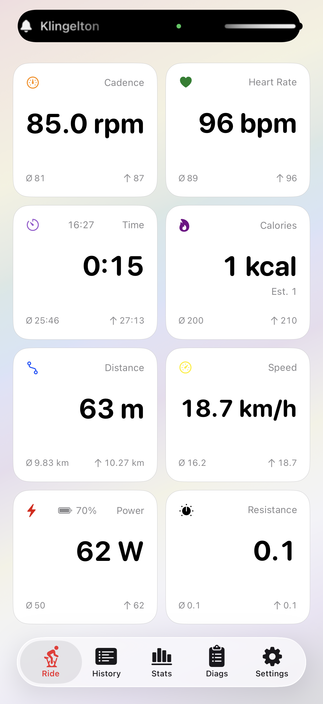
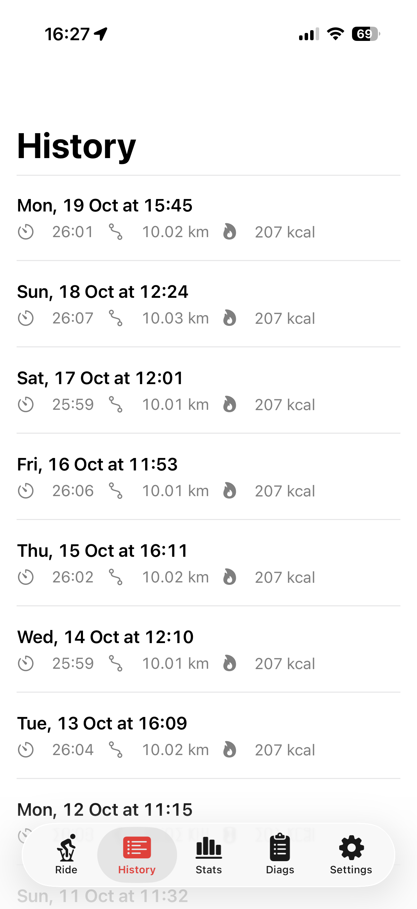
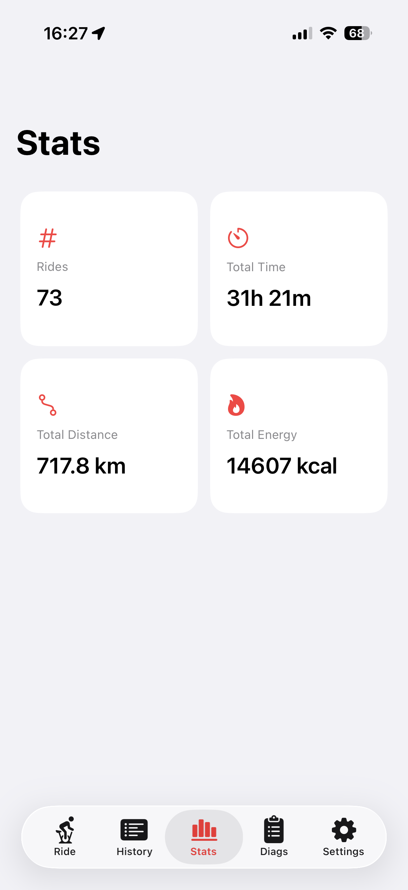
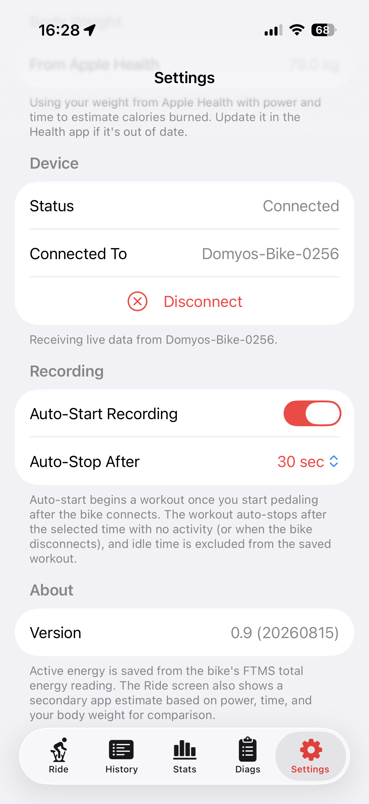
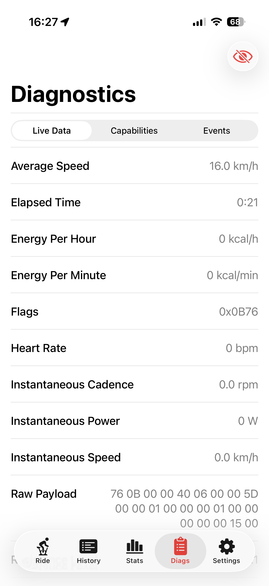
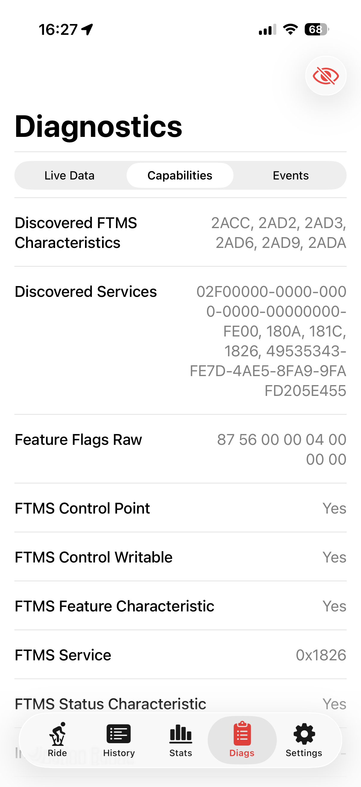
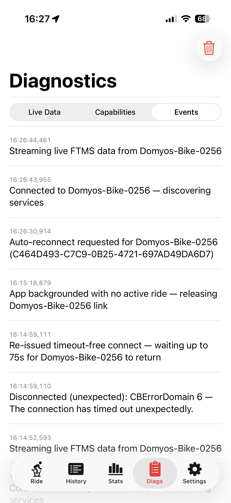

# domyos

Your indoor ride at a glance. **domyos** connects your exercise bike to your iPhone or iPad over Bluetooth, displays live training metrics, and saves your rides to Apple Health as indoor cycling workouts.

Built with SwiftUI for the **Decathlon EB900 B (Domyos)**, the app reads workout data through the Bluetooth Fitness Machine Service (FTMS). The app interface is in English.

## Screenshots

<table>
  <tr>
    <th>Live dashboard</th>
    <th>Ride history</th>
    <th>Statistics</th>
    <th>Settings</th>
  </tr>
  <tr>
    <td><a href="assets/screenshots/IMG_3302.PNG"></a></td>
    <td><a href="assets/screenshots/IMG_3303.PNG"></a></td>
    <td><a href="assets/screenshots/IMG_3304.PNG"></a></td>
    <td><a href="assets/screenshots/IMG_3308.PNG"></a></td>
  </tr>
</table>

<details>
<summary>Explore the Bluetooth diagnostics</summary>

<table>
  <tr>
    <th>Live FTMS data</th>
    <th>Device capabilities</th>
    <th>Connection events</th>
  </tr>
  <tr>
    <td><a href="assets/screenshots/IMG_3305.PNG"></a></td>
    <td><a href="assets/screenshots/IMG_3306.PNG"></a></td>
    <td><a href="assets/screenshots/IMG_3307.PNG"></a></td>
  </tr>
</table>

</details>

## Features

- **Live dashboard:** Power, cadence, speed, heart rate, distance, calories, time, and resistance across eight tiles, with averages and maximums where applicable.
- **Customizable layout:** Long-press and drag to reorder tiles. The dashboard adapts to portrait and landscape; tap the background in landscape to hide the tab bar.
- **Automatic recording:** Start recording when you begin pedaling after connecting. Choose an inactivity timeout between 15 seconds and two minutes. In the foreground, an inactivity prompt lets you keep recording, pause, or save; an unanswered prompt saves the ride after a countdown. In the background, recording stops automatically after inactivity.
- **Apple Health:** Save indoor cycling workouts with available heart rate, power, cadence, speed, distance, and active energy data. Trailing idle time is trimmed when a ride stops automatically.
- **Live Activity:** See training metrics on the Lock Screen and in the Dynamic Island on supported devices. An ongoing ride can continue recording while the screen is locked.
- **History and statistics:** Review saved rides, delete them from Apple Health, and track total rides, time, distance, and energy. History and totals include workouts saved by this app.
- **Automatic reconnection:** Remember the last connected bike and attempt to reconnect after brief Bluetooth interruptions before ending the ride.
- **Diagnostics:** Inspect received FTMS data, device capabilities, and connection events inside the app.

## Requirements and compatibility

- An iPhone or iPad running **iOS / iPadOS 26.5 or later**, matching the current deployment target.
- A Bluetooth LE exercise bike exposing the **Fitness Machine Service (`0x1826`)** and **Indoor Bike Data (`0x2AD2`)**.
- Bluetooth access and the appropriate Apple Health permissions for recording and workout history.

This app has only been tested with the **Decathlon EB900 B (Domyos)**. Support for additional devices is not planned by the maintainer. Other FTMS bikes may work, but compatibility is unverified; adapting the app for other hardware is left to community contributions or forks.

Available metrics depend on what the bike actually transmits. Heart rate is read from the bike's data stream; connecting directly to a separate heart rate strap is not currently implemented.

The app reads training data. Resistance control and ERG mode are not currently implemented.

## Your first ride

1. Turn on the bike and enable Bluetooth on your iPhone or iPad.
2. Open the app and grant the requested Bluetooth and Health permissions.
3. Check the connection in **Settings**. The app searches for an FTMS bike automatically; you can also tap **Scan for Bike**. A scan connects to the first FTMS device discovered.
4. Start pedaling. With **Auto-Start Recording** enabled, recording begins automatically. The app switches to **Ride** once the bike connects.
5. To start or stop recording manually, tap the **Ride** tab again while it is already selected. Saved rides appear in **History**, with totals in **Stats**.

Use **Settings** to adjust auto-start, the inactivity timeout, and body weight. When no ride is recording, the app releases the bike connection upon entering the background.

## Calories and body weight

Active energy saved with a workout comes from the bike's cumulative FTMS calorie reading. The dashboard also shows a separate **Est.** value calculated from power, time, and body weight for comparison. This estimate does not replace the bike's reading when saving a workout.

For the estimate, the app uses the latest body weight available from Apple Health, falling back to the manual entry in **Settings**. If neither is available, it assumes 75 kg.

## Data and privacy

The app requires no app-specific account and uses no backend server. Workouts are saved to Apple Health through HealthKit. Settings, the last connected bike, and a limited connection log are stored locally on the device. The current source code includes no analytics or tracking services.

## Build from source

You need a Mac and Xcode with an SDK that supports the current iOS 26.5 deployment target. The project uses Swift 6 and Apple frameworks with no external package dependencies.

1. Clone the repository and open `domyos.xcodeproj` in Xcode.
2. Select the **domyos** scheme.
3. Under **Signing & Capabilities**, select your own development team for the **domyos** and **DomyosWidgetExtension** targets. Adjust the bundle identifiers if needed and keep the app target's HealthKit capability enabled.
4. Select a connected device and choose **Run**.

In the iOS Simulator, the app automatically generates simulated ride metrics for dashboard development. Test actual Bluetooth connectivity on a physical device.

### Tests

Run **Product → Test** or press **⌘U** in Xcode. The project includes unit tests in `domyosTests` and UI tests in `domyosUITests`.

### Versioning

The app version and build number are defined in [`domyos/Version.xcconfig`](domyos/Version.xcconfig). To enable the optional Git hooks:

```sh
sh scripts/install-git-hooks.sh
```

The pre-commit hook increments the minor version on each commit, sets the build number to the current date, and stages the updated version file.

## Project structure

| Component | Purpose |
| --- | --- |
| `domyos/BikeManager.swift` | Bluetooth connections, device discovery, and reconnection |
| `domyos/FTMSParser.swift` | FTMS data packet parsing |
| `domyos/WorkoutRecorder.swift` | Recording, inactivity handling, and HealthKit persistence |
| `domyos/WorkoutStore.swift` | Loading and deleting saved rides |
| `domyos/RiderProfile.swift` | Body weight from Health or manual entry |
| `domyos/*View.swift` | Dashboard, history, statistics, diagnostics, and settings |
| `DomyosWidget/` | Live Activity for the Lock Screen and Dynamic Island |

## License and credits

[ductco.de](https://ductco.de) – **Coded with ❤️ in the 🇪🇺**

Licensed under the [MIT License](LICENSE).

Redistributions must retain the copyright and license notices as required by the license. If you build on this project, a visible credit to [ductco.de](https://ductco.de) is appreciated, but is not an additional license requirement.
